# Diagramas para Excalidraw

Versión de los diagramas de [`ARQUITECTURA.md`](./ARQUITECTURA.md) preparada
para **Excalidraw**, con color.

## Cómo usarlos

1. Abre [excalidraw.com](https://excalidraw.com).
2. Menú → **Mermaid to Excalidraw** (o pega la definición directamente en el
   lienzo).
3. Copia **un solo bloque** de los de abajo y pégalo.

Salen formas, flechas y texto **editables**, no una imagen.

## Qué se respetó para que funcionen

Excalidraw convierte con `@excalidraw/mermaid-to-excalidraw`, que no soporta
todo Mermaid. Estos diagramas se ajustan a sus reglas:

- Solo **flowchart**, **sequenceDiagram** y **erDiagram**.
- El color va con **`classDef` + `class`**, que es lo que el conversor sí
  traslada. Los estilos aplicados a un `subgraph` **se ignoran**
  ([issue #10720](https://github.com/excalidraw/excalidraw/issues/10720)), así
  que aquí no se usan: el color está siempre en los nodos.
- Solo formas que el conversor conserva: rectángulo, redondeado `(...)`,
  estadio `([...])` y rombo `{...}`. Las demás (hexágono, cilindro) se
  convertirían en rectángulos, así que las bases de datos se marcan con color y
  forma de estadio en lugar de con el cilindro habitual.
- Etiquetas cortas: en una pizarra el texto largo se vuelve ilegible.

> Si un diagrama falla al convertirse, Excalidraw lo inserta como **imagen** en
> vez de como formas. Los ocho de abajo se probaron y generan elementos
> editables.

---

## 1. Visión general

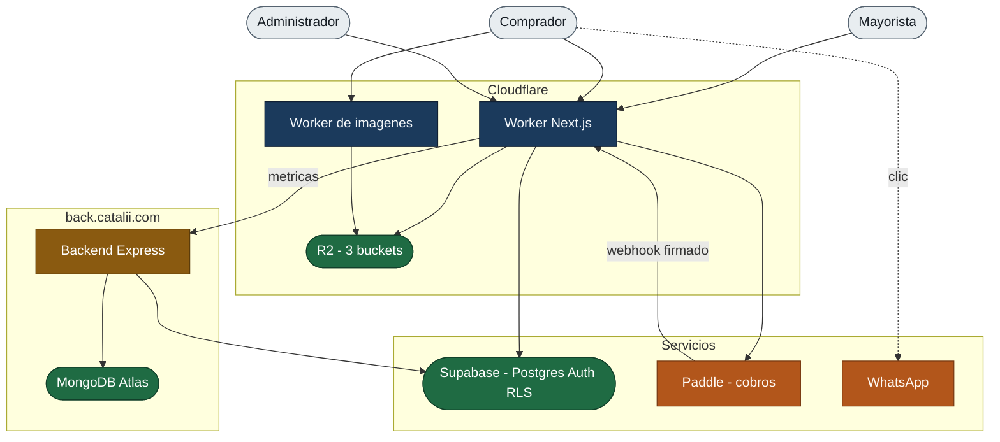

---

## 2. Pedido de un comprador

El flujo central: el único que escribe en la base sin sesión.

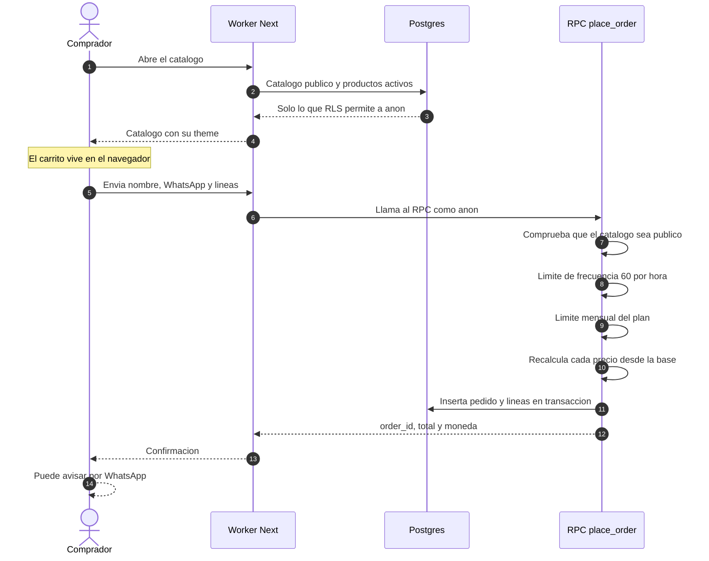

---

## 3. Cobro con Paddle

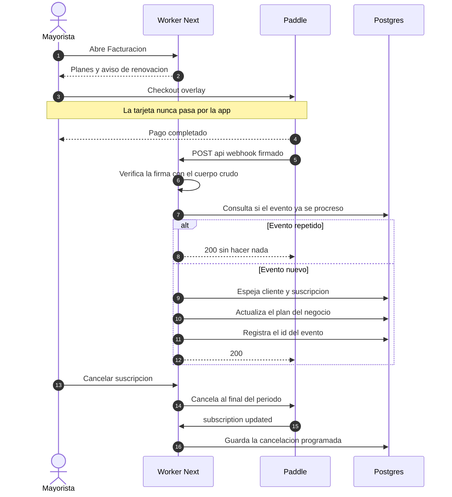

---

## 4. Métricas en MongoDB

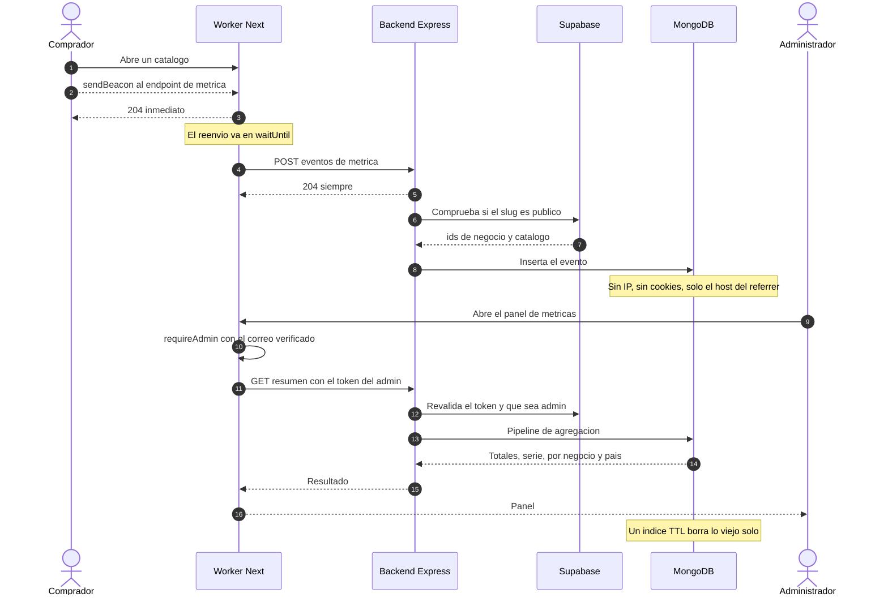

---

## 5. Modelo de datos en PostgreSQL

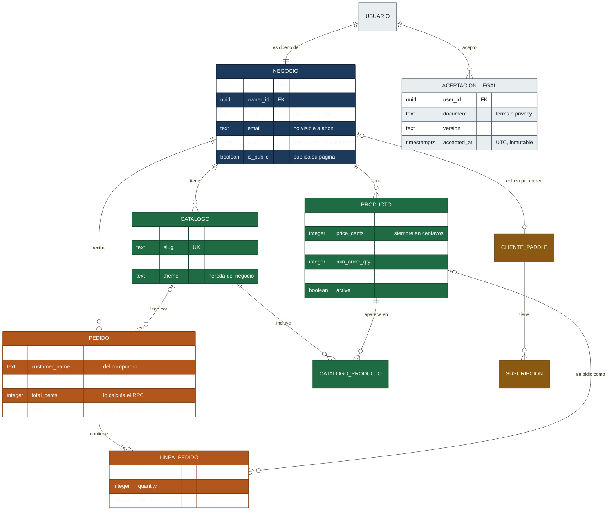

Los colores separan de un vistazo lo que es **del mayorista** (verde), lo que
**entra de fuera** (terracota, los pedidos de compradores anónimos), lo que
toca **dinero** (dorado) y lo que es **de la cuenta** (gris).

---

## 6. Colección de MongoDB

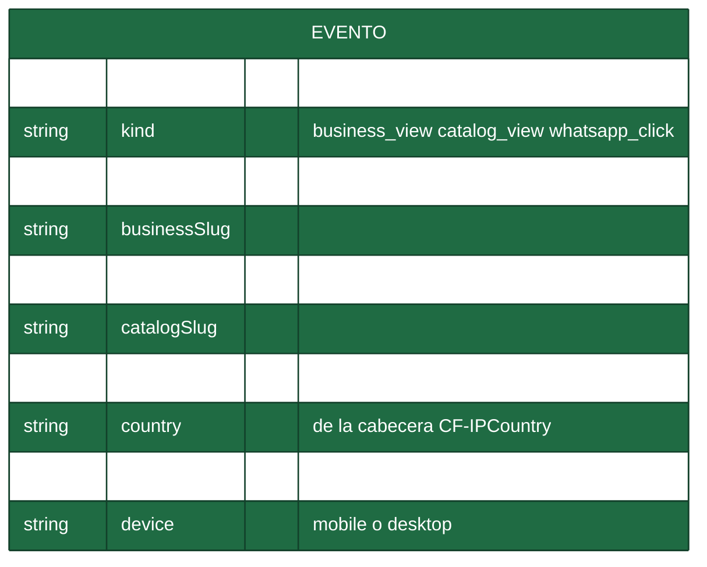

Sin relaciones porque son eventos independientes: el cruce con Postgres se hace
por `businessId` al consultar.

---

## 7. Seguridad por capas

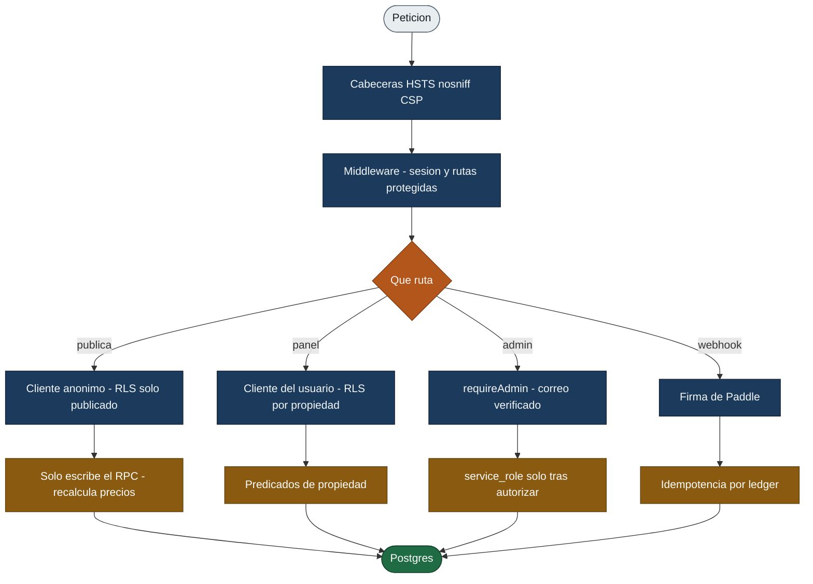

---

## 8. Despliegue

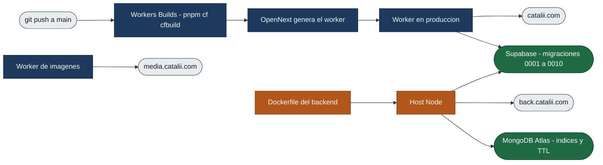

En naranja, lo que **todavía no está desplegado**: el backend Express. El Worker
de imágenes tampoco tiene dominio conectado.

---

## 9. Mapa de rutas

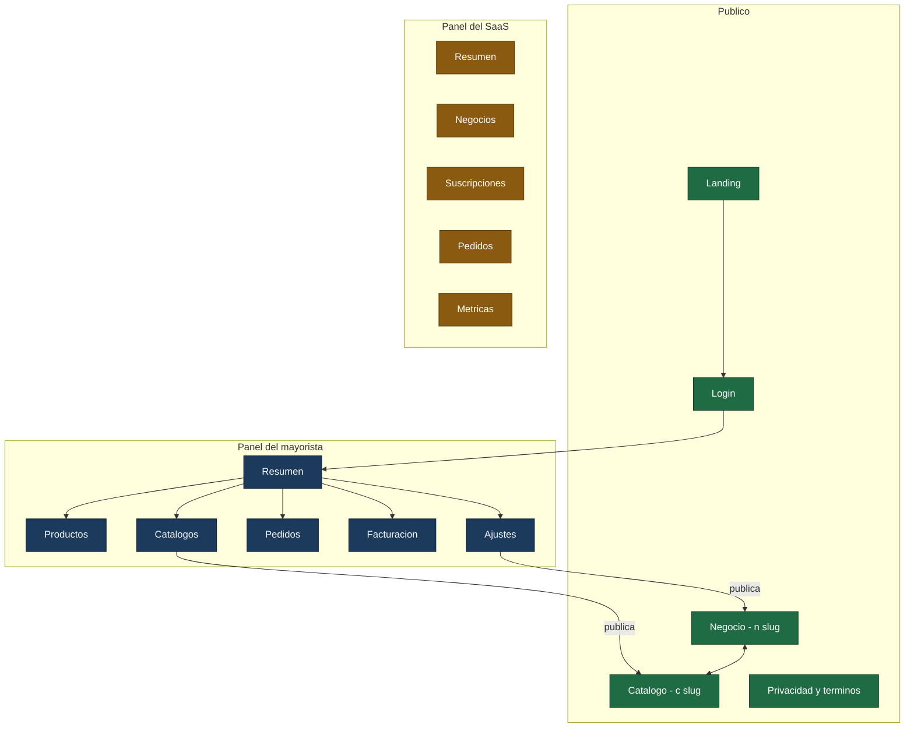

---

## 10. Alta de un mayorista

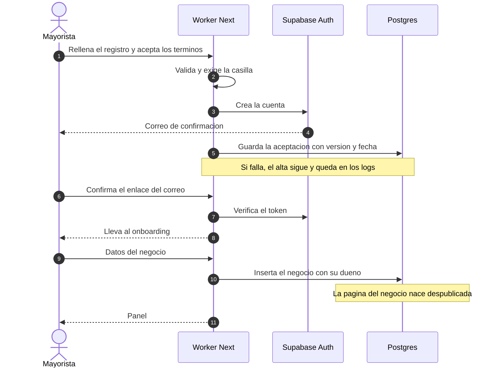

---

## 11. Subida de imágenes

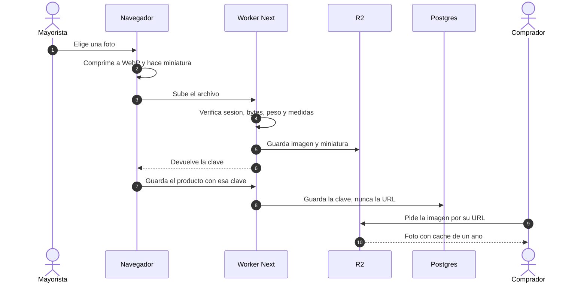
