# Arquitectura de Catalii

Diagramas del sistema tal como está hoy, no como se planeó. Donde algo está a
medias o en pausa, se dice.

Los diagramas son [Mermaid](https://mermaid.js.org/): GitHub, GitLab y VS Code
los dibujan solos al abrir este archivo.

---

## 1. Visión general

Tres piezas desplegadas por separado, y una base de datos como fuente de verdad.

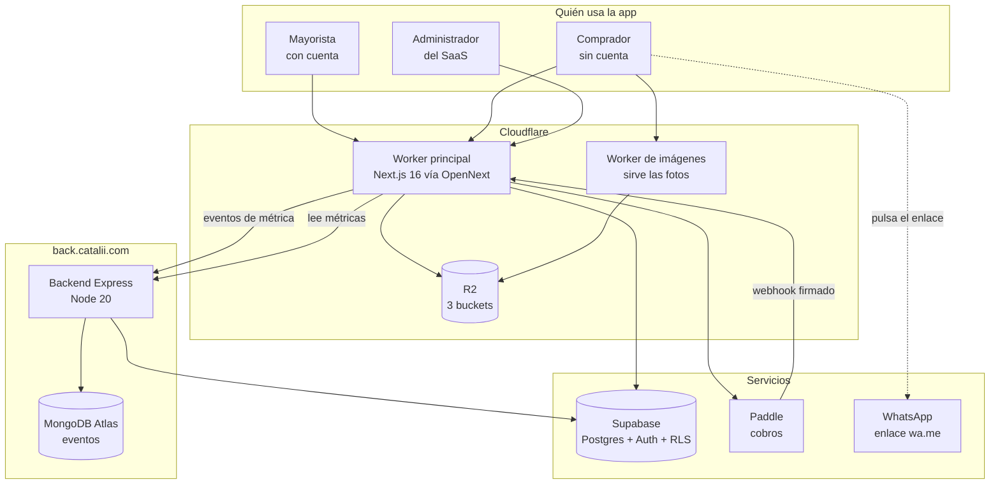

**Por qué Mongo vive en el backend y no en el Worker:** el driver funciona en
Workers, pero [Cloudflare advierte](https://developers.cloudflare.com/workers/databases/third-party-integrations/mongodb/)
que cada invocación abre una conexión TCP y TLS nueva, unos 300 ms, y
Hyperdrive no soporta Mongo. El backend es Node, mantiene un pool y no paga ese
coste.

---

## 2. Tecnologías

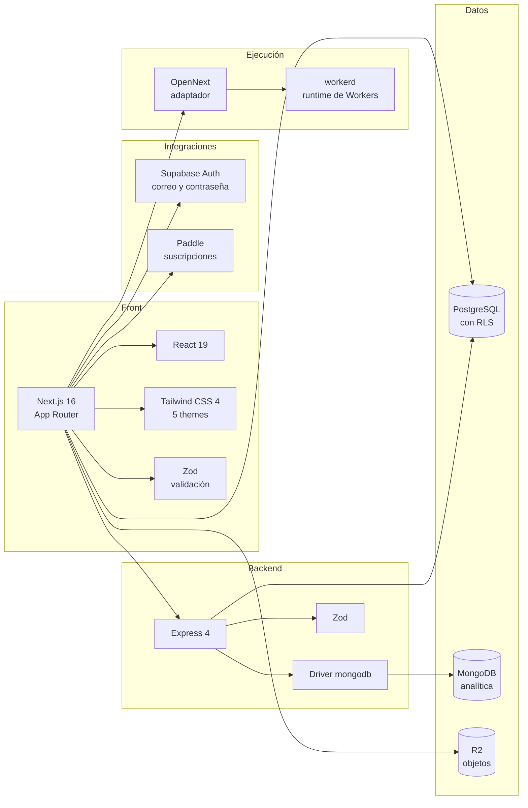

| Capa | Qué se usa | Por qué |
|---|---|---|
| Interfaz | Next.js 16 (App Router), React 19, Tailwind 4 | Renderizado en servidor y Server Actions, sin API propia para el panel |
| Datos transaccionales | PostgreSQL en Supabase, con RLS en todas las tablas | Relaciones, transacciones y aislamiento por negocio en la propia base |
| Analítica | MongoDB Atlas | Eventos append-only de forma variable, agregaciones y retención por TTL |
| Imágenes | Cloudflare R2 + Worker aparte | Servir fotos sin pasar por el runtime de la app |
| Autenticación | Supabase Auth (correo y contraseña) | Sesión en cookie, verificada en el servidor en cada petición |
| Cobros | Paddle (merchant of record) | Suscripciones e impuestos sin tocar datos de tarjeta |
| Validación | Zod, en front y backend | El mismo contrato en las dos capas |
| Despliegue | Cloudflare Workers (app), Docker (backend) | — |

---

## 3. Mapa de rutas

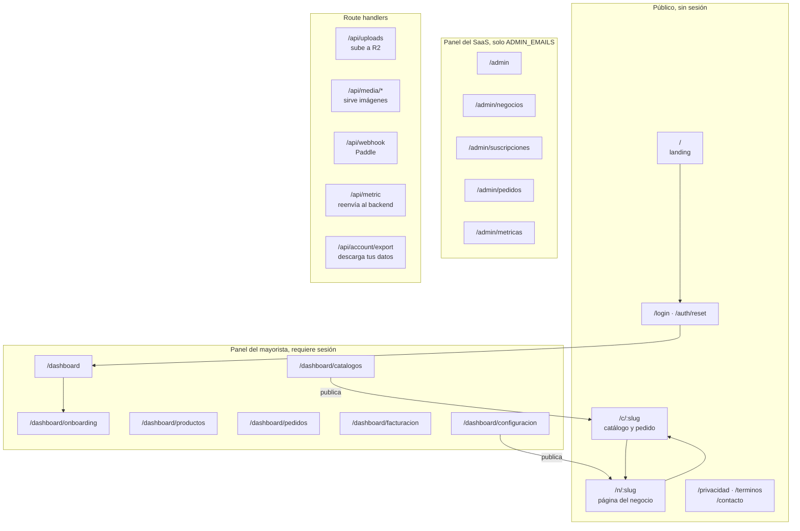

Todas las rutas se renderizan por petición. La Content-Security-Policy usa un
nonce distinto en cada visita, y eso obliga a leer cabeceras en el layout, así
que no queda HTML prerenderizado. Fue un cambio consciente: seguridad a cambio
de algo de CPU por visita.

---

## 4. Alta de un mayorista

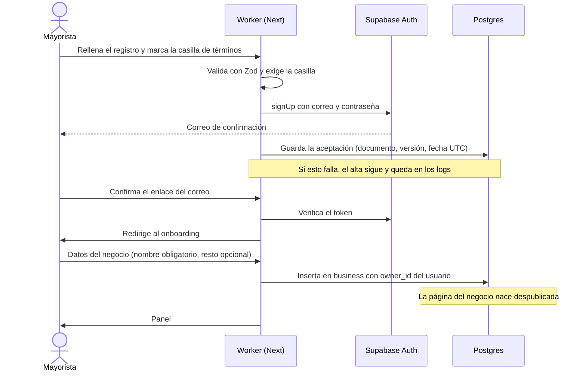

---

## 5. Pedido de un comprador

El flujo más importante, y el único que escribe sin sesión.

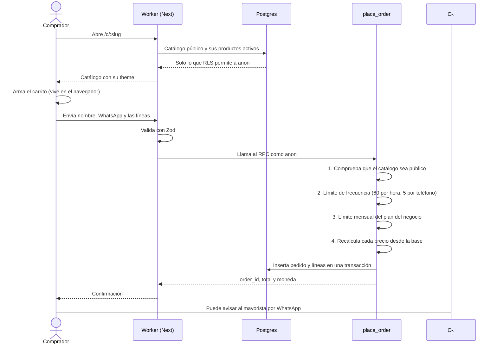

**El cliente nunca fija el precio.** El RPC lo recalcula desde la base, así que
manipular el carrito en el navegador no cambia el importe. Y es
`security definer`, la única vía por la que `anon` puede escribir.

---

## 6. Suscripción y cobro

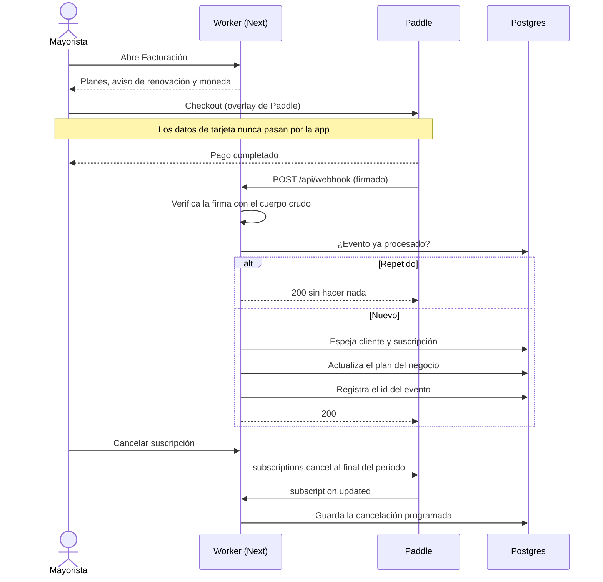

El enlace entre Paddle y el negocio se hace **por correo electrónico**. Si el
correo de Paddle no coincide con el del negocio, el pago se registra pero el
plan no se aplica; eso queda en los logs del webhook.

---

## 7. Imágenes

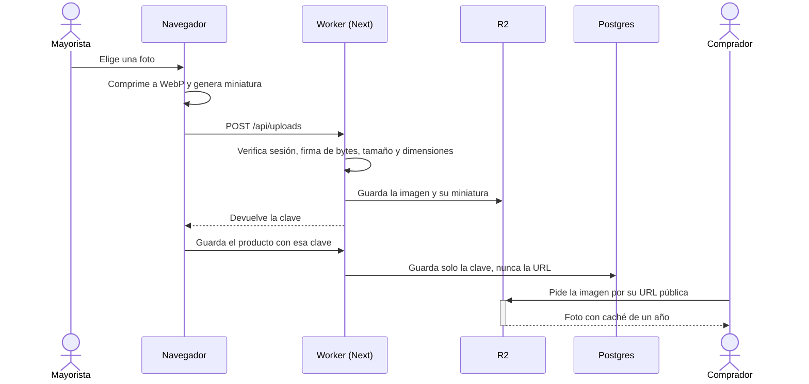

En la base se guarda **la clave**, no la URL. Así cambiar de dominio de
imágenes no obliga a migrar datos.

---

## 8. Métricas en MongoDB

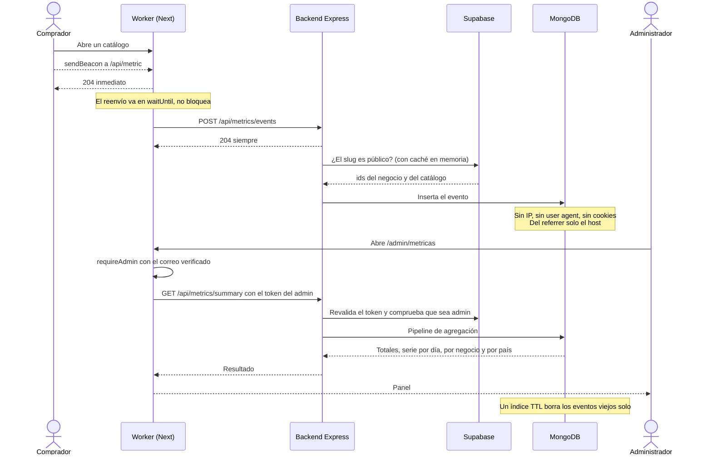

Si Mongo o el backend no responden, el panel dice que las métricas no están
disponibles **en lugar de pintar ceros**, que se leerían como "nadie visitó".
Y un fallo ahí no afecta a pedidos ni a pagos.

---

## 9. Modelo de datos

### PostgreSQL (fuente de verdad)

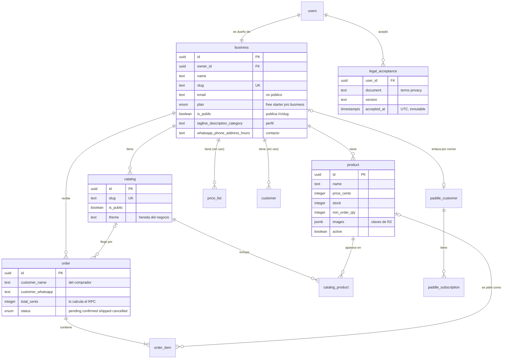

Tablas de apoyo: `processed_webhook` (idempotencia de Paddle, con purga a 90
días). `price_list` y `customer` existen desde el inicio y **ningún código las
usa**.

### MongoDB (analítica)

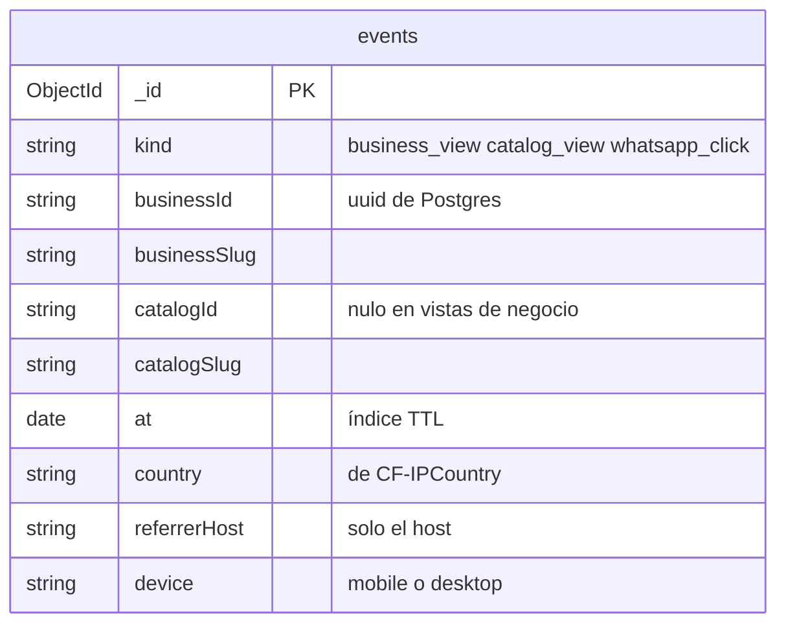

No hay relaciones porque no hay nada que relacionar: son eventos
independientes. El cruce con Postgres se hace por `businessId` al consultar.

---

## 10. Seguridad por capas

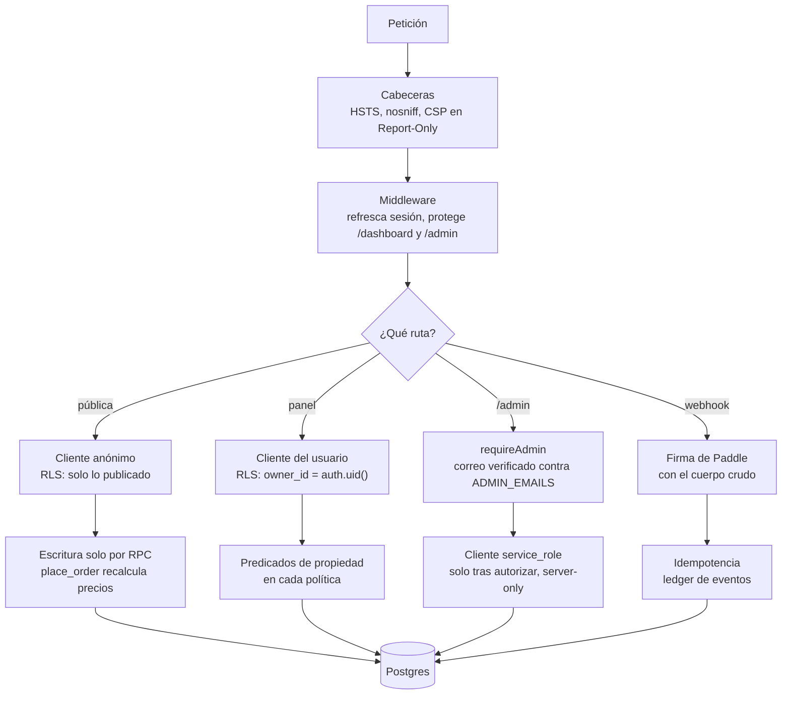

Lo que conviene tener presente:

- **RLS en todas las tablas**, con predicados de propiedad, no solo
  `TO authenticated`.
- El `service_role` está marcado `server-only` y solo se usa en el webhook, el
  borrado de cuenta, el registro de aceptaciones y el panel de administración,
  siempre **después** de autorizar.
- La **CSP va en Report-Only**: hoy informa pero no bloquea. Pasa a bloqueo con
  `CSP_MODE=enforce`, y antes hay que confirmar los dominios del checkout de
  Paddle (tareas #51 y #18 de `PENDIENTES.md`).
- A quien no es administrador se le responde **404 y no 403**, para no
  confirmar que `/admin` existe.

---

## 11. Despliegue

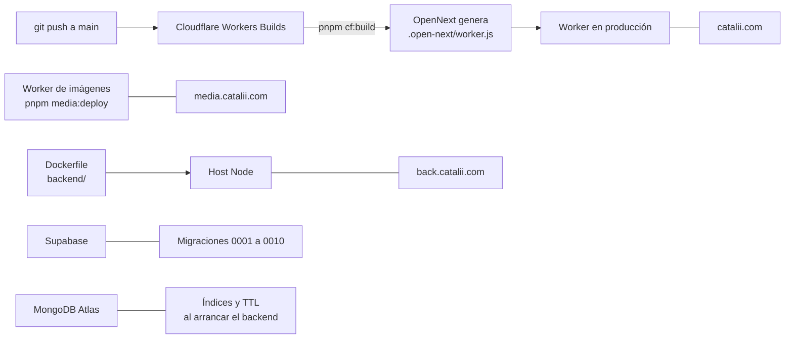

| Pieza | Estado |
|---|---|
| Worker principal | Despliega desde Git en cada push |
| Migraciones | `0001`–`0009` aplicadas · **`0010` pendiente** |
| Backend Express | Dockerfile listo, **sin desplegar** |
| MongoDB Atlas | Cluster en creación |
| Worker de imágenes | Sin dominio conectado |

Las variables `NEXT_PUBLIC_*` se incrustan **en el build**; los secretos
(`SUPABASE_SERVICE_ROLE_KEY`, `PADDLE_API_KEY`,
`PADDLE_NOTIFICATION_WEBHOOK_SECRET`, `ADMIN_EMAILS`) son secretos del Worker.
El backend necesita además `MONGODB_URI`.

---

## 12. Lo que está a medias

Para que el diagrama no engañe:

- **El backend solo se usa para métricas.** Tiene endpoints de productos,
  catálogos y pedidos, y el front sabe llamarlos, pero esa migración está en
  pausa (tarea #25). Con `BACKEND_URL` vacía, todo va directo a Supabase.
- **La CSP no bloquea todavía** (#51).
- **`price_list` y `customer`** son tablas sin usar (#33).
- **Sin tests ni CI** (#50).

El detalle de cada punto está en [`PENDIENTES.md`](../PENDIENTES.md).
